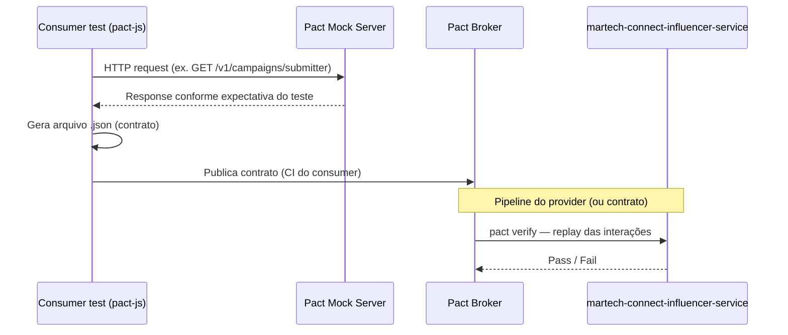

# Guia de automação — Testes de contrato de API (Pact)

> **Para:** Cursor / agentes de automação e QA  
> **Escopo:** [MARTGNM-5948](https://ab-inbev.atlassian.net/browse/MARTGNM-5948) e [MARTGNM-5955](https://ab-inbev.atlassian.net/browse/MARTGNM-5955)  
> **Epic:** [MARTGNM-5655](https://ab-inbev.atlassian.net/browse/MARTGNM-5655) (IATC KPI)  
> **Framework:** `@pact-foundation/pact` (pact-js) · Node.js

Este documento explica **o que automatizar**, **quem é consumer vs provider**, **quais validações travar no contrato** e **como mapear cada cenário Zephyr** para código pact-js executável em CI.

---

## 1. Rastreabilidade (Jira ↔ Zephyr ↔ código)

| Issue | Endpoint | Pasta Zephyr | Test Cases | Ciclo | Feature file |
|-------|----------|--------------|------------|-------|--------------|
| MARTGNM-5948 | `GET /v1/campaigns/submitter` | `Sprint 199/MARTGNM-5948` | T2719–T2722 (4) | **MARTGNM-R249** | `sprints/sprint 199/MARTGNM-5948-campaigns-submitter-pact.feature` |
| MARTGNM-5955 | `GET /v1/campaigns/brand-lead` | `Sprint 199/MARTGNM-5955` | T2723–T2727 (5) | **MARTGNM-R250** | `sprints/sprint 199/MARTGNM-5955-campaigns-brand-lead-pact.feature` |

**Labels Zephyr (filtro `automated`):** `automated`, `contract-testing`, `pact-js`, `api-contract`, `influencer-api`

**Referências técnicas:**

- OpenAPI UAT: [martech-connect-influencer-service v1](https://services.martech.uat.mybees-platform.dev/api/martech-connect-influencer-service/v1/docs#/)
- Confluence (inventário APIs críticas): [API contract test endpoints — Influencer v1](https://ab-inbev.atlassian.net/wiki/spaces/ONEWAY/pages/6339723454)
- Evidência manual: Postman MARTGNM-5716 (submitter) · MARTGNM-5717 (brand-lead)

---

## 2. O que é teste de contrato de API com Pact (visão expert)

### 2.1 Problema que resolve

Testes de integração tradicionais (E2E, Postman manual) validam **comportamento em um ambiente**, mas não impedem que o **provider mude o contrato** (campos removidos, tipos alterados, status HTTP diferentes) e quebre consumidores em produção **sem** o time de backend perceber.

**Consumer-Driven Contract Testing (CDCT)** inverte a lógica:

1. O **consumer** declara: *"eu chamo este endpoint assim e espero esta resposta"*.
2. Isso vira um **arquivo de contrato** (pact JSON).
3. O **provider** roda **provider verification** e prova que ainda honra todos os contratos publicados.

O Pact **não substitui** testes unitários nem E2E. Ele garante **compatibilidade de interface HTTP** entre serviços.

### 2.2 O que o Pact valida (e o que não valida)

| Valida | Não valida |
|--------|------------|
| Método, path, query params, headers mínimos | Lógica de negócio completa |
| Status HTTP acordado | Performance / carga |
| Forma do body (campos, tipos, estrutura) | Dados reais do banco (use matchers flexíveis) |
| Que o provider responde conforme o contrato | UI, fluxos de usuário |
| Breaking changes antes do deploy | Segurança profunda (pen test) |

### 2.3 Fluxo típico (duas pernas)



**Consumer test** roda **sem** o provider real — usa mock local do Pact.  
**Provider verification** roda **contra** o serviço real (SIT/UAT) ou stub acordado.

---

## 3. Quem é Consumer, quem é Provider — e quem NÃO é

### 3.1 Papéis neste projeto

| Papel | Nome no Pact | O que é | Responsabilidade no contrato |
|-------|--------------|---------|------------------------------|
| **Provider** | `martech-connect-influencer-service` | API backend (Node/Java — serviço Connect Influencer) | Implementar endpoints; passar `pact verify` |
| **Consumer** | `connect-influencer-web` | Frontend web **ou** BFF que consome a API | Escrever consumer tests; publicar contratos |

> Se existir um **BFF** entre o browser e o serviço, o consumer no Pact deve ser o **componente que faz o HTTP direto ao provider** — normalmente o BFF, não o React em si. Ajuste o `consumer` name no pact para o nome acordado com platform/backend (hoje documentado como `connect-influencer-web`).

### 3.2 Quem NÃO é consumer

| Componente | Por quê não é consumer aqui |
|------------|----------------------------|
| `martech-connect-influencer-service` | É o **provider** — quem expõe a API |
| Zephyr / Jira | Ferramentas de gestão de testes — **não executam** pact |
| Postman / coleções manuais | Evidência exploratória — **não gera** contrato versionado |
| OpenAPI spec sozinha | Documentação — pode **divergir** do runtime; Pact trava o que o consumer realmente usa |
| Pact Broker | Repositório de contratos — **não** consome nem provê API de negócio |
| Testes E2E (Cypress/Playwright) | Testam jornada UI — contrato HTTP fica acoplado demais e frágil |

### 3.3 Onde o código deve viver

Conforme as issues, criar pacote:

```text
tests/contract/
├── consumer/
│   ├── submitter.campaigns.pact.spec.ts    # MARTGNM-5948 → T2719–T2722
│   └── brand-lead.campaigns.pact.spec.ts   # MARTGNM-5955 → T2723–T2727
├── helpers/
│   ├── pact-config.ts                      # provider, consumer, broker URL
│   ├── matchers.ts                         # like, eachLike, regex, uuid
│   └── auth.ts                             # Bearer token / mock
└── pacts/                                  # gerado — não editar manualmente
```

O **Cursor deve automatizar os arquivos em `tests/contract/consumer/`** e o job de CI — **não** reimplementar lógica dentro dos `.feature` do Zephyr (esses são rastreabilidade BDD; a execução real é pact-js).

---

## 4. Configuração base pact-js (o que o Cursor deve gerar)

```typescript
// tests/contract/helpers/pact-config.ts (referência)
import path from 'path';
import { Pact } from '@pact-foundation/pact';

export const PROVIDER = 'martech-connect-influencer-service';
export const CONSUMER = 'connect-influencer-web';

export function createPact(suffix: string) {
  return new Pact({
    consumer: CONSUMER,
    provider: PROVIDER,
    port: 0, // porta dinâmica
    log: path.resolve(process.cwd(), 'logs', `pact-${suffix}.log`),
    dir: path.resolve(process.cwd(), 'tests/contract/pacts'),
    pactfileWriteMode: 'update',
  });
}
```

**Variáveis de ambiente esperadas:**

| Variável | Uso |
|----------|-----|
| `PACT_BROKER_BASE_URL` | Publicação e verify via broker |
| `PACT_BROKER_TOKEN` | Auth no broker |
| `CONTRACT_TEST_BEARER_TOKEN` | Token SIT/UAT para provider verify (ou mock em consumer-only) |
| `PROVIDER_BASE_URL` | Base URL do provider em verify (ex. UAT) |

---

## 5. MARTGNM-5948 — GET `/v1/campaigns/submitter`

**Ciclo Zephyr:** MARTGNM-R249  
**Prioridade:** P0

### C1 → MARTGNM-T2719 — Happy path 200

**Request a travar:**

```http
GET /v1/campaigns/submitter?group=draft&page=1&pageSize=25
Authorization: Bearer <token>
Accept: application/json
```

**Validações (matchers recomendados):**

| Campo | Matcher | Motivo |
|-------|---------|--------|
| Status | `200` exato | Consumer depende de sucesso |
| `Content-Type` | `application/json` | Parser do client |
| Body | objeto com `items` (array) | Envelope paginado OpenAPI |
| `items[]` | `eachLike` com `id`, `name`, `status` | Campos mínimos usados na UI |
| `id` | `uuid` ou `string` | Identificador estável |
| `name` | `string` | Exibição |
| `status` | `term` ou `regex` | Enum de status de campanha |
| Metadados paginação | `like` em `page`, `pageSize`, `total` (se existirem no OpenAPI) | Paginação client-side |

**O que o teste consumer faz:**

1. `await provider.addInteraction({ ... })` com request/response esperados.
2. Chama o **client HTTP do consumer** (não `fetch` solto no teste) apontando para `provider.mockService.baseUrl`.
3. Assert no client code (status, shape parseado).
4. `await provider.verify()` — gera/atualiza o pact JSON.

### C2 → MARTGNM-T2720 — 400 sem `group`

**Request:**

```http
GET /v1/campaigns/submitter?page=1&pageSize=25
Authorization: Bearer <token>
```

**Validações:**

| Campo | Matcher |
|-------|---------|
| Status | `400` exato |
| Body erro | estrutura estável — ex. `{ message: string }` ou `{ error: string, code: string }` conforme OpenAPI/Postman C4b |

> **Regra expert:** trave a **forma** do erro, não a mensagem literal (use `like` ou `regex` só se a mensagem for contrato estável).

### C3 → MARTGNM-T2721 — 401/403 sem Authorization

**Request:**

```http
GET /v1/campaigns/submitter?group=draft&page=1&pageSize=25
(sem header Authorization)
```

**Validações:**

| Campo | Matcher |
|-------|---------|
| Status | `401` **ou** `403` — escolher **um** após smoke manual e travar o mesmo no pact |
| Body | envelope de erro não autorizado (campos estáveis) |

> Pact exige status **exato** por interação. Se UAT retorna `401` e SIT `403`, defina **um** como contrato oficial ou crie **duas interações** nomeadas (não um OR no mesmo teste).

### C4 → MARTGNM-T2722 — Provider verification

**Não é consumer test** — é job de CI/pipeline:

```bash
pact-broker can-i-deploy --pacticipant connect-influencer-web --version $GIT_SHA
# ou
npm run pact:verify -- --provider-base-url=$PROVIDER_BASE_URL
```

**Validações:**

- Todas as interações de `GET /v1/campaigns/submitter` passam contra o provider.
- Job CI verde.
- (Opcional) publicar resultado no Pact Broker (`provider-verification-results`).

---

## 6. MARTGNM-5955 — GET `/v1/campaigns/brand-lead`

**Ciclo Zephyr:** MARTGNM-R250  
**Prioridade:** P0

### C1 → MARTGNM-T2723 — Happy path 200

**Request:**

```http
GET /v1/campaigns/brand-lead?group=in_progress&page=1&pageSize=25
Authorization: Bearer <token>
```

**Validações:** iguais ao C1 de submitter (envelope paginado + `items[].id|name|status`).

**Valores de `group` válidos (domínio):** `draft` | `in_progress` | `archived` — usar o valor do cenário (`in_progress`).

### C2 → MARTGNM-T2724 — 400 sem `group`

Mesmo padrão do MARTGNM-5948 C2, path `/v1/campaigns/brand-lead`.

### C3 → MARTGNM-T2725 — Filtros `marketId` + `brandId`

**Request:**

```http
GET /v1/campaigns/brand-lead?group=draft&marketId={uuid}&brandId={uuid}&page=1&pageSize=25
Authorization: Bearer <token>
```

**Validações:**

| Campo | Matcher |
|-------|---------|
| Status | `200` |
| `items` | `eachLike` com campos mínimos — **não** fixar quantidade de itens |
| `items.length` | **não** usar matcher rígido — cardinalidade muda com dados |

**Fixtures:** UUIDs de `marketId`/`brandId` vindos de GET de referência em UAT ou arquivo `tests/contract/fixtures/brand-lead-filters.json`.

### C4 → MARTGNM-T2726 — 401/403 sem Authorization

Mesmo padrão do MARTGNM-5948 C3, path `/v1/campaigns/brand-lead`, `group=in_progress`.

### C5 → MARTGNM-T2727 — Provider verification

Igual ao C4 de submitter, escopo `GET /v1/campaigns/brand-lead`.

---

## 7. Matchers Pact — guia prático para o Cursor

```typescript
import { Matchers } from '@pact-foundation/pact';
const { like, eachLike, uuid, integer, regex } = Matchers;

// Envelope paginado (ajustar ao OpenAPI real)
const paginatedCampaigns = {
  items: eachLike({
    id: uuid(),
    name: like('Summer Campaign'),
    status: regex('(draft|in_progress|archived|published)', 'draft'),
  }),
  page: integer(1),
  pageSize: integer(25),
  total: integer(100),
};

// Erro 400 — missing group
const missingGroupError = like({
  message: like('group is required'),
  // incluir outros campos estáveis do OpenAPI
});
```

**Princípios expert:**

1. **Mínimo necessário** — só trave campos que o consumer **lê** (YAGNI no contrato).
2. **Matchers flexíveis** — `like` > valor literal; evita falsos negativos por copy dinâmico.
3. **Smoke manual antes de travar** — issues alertam que OpenAPI pode divergir do UAT.
4. **Uma interação = um comportamento** — não misturar 200 e 400 no mesmo `it()`.
5. **Provider state** (opcional) — se o provider precisar de dados seed, usar `given: 'campaigns exist for group draft'` e implementar handler no provider verify.

---

## 8. O que o Cursor deve automatizar (checklist)

### 8.1 Consumer tests (obrigatório)

- [ ] Instalar `@pact-foundation/pact` e runner (Jest/Vitest/Mocha).
- [ ] Implementar client HTTP reutilizado pelo app (ou módulo espelhando o BFF).
- [ ] Um `describe` por feature file / issue.
- [ ] Um `it()` por cenário Zephyr (T2719…T2727).
- [ ] Gerar pact em `tests/contract/pacts/`.
- [ ] Publicar no Pact Broker no CI do consumer (`pact-broker publish`).

### 8.2 Provider verification (obrigatório para Done)

- [ ] Script `pact:verify` no repositório do **provider** ou pipeline de contrato centralizado.
- [ ] `providerBaseUrl` apontando para UAT (ou stub local na primeira entrega).
- [ ] Auth: Bearer token via env ou provider state que bypassa auth **apenas** em ambiente de contrato.
- [ ] Falhar build se verify quebrar.

### 8.3 CI (obrigatório)

- [ ] Job `contract-tests` em PR do consumer.
- [ ] Job `pact-verify` no pipeline do provider (ou nightly + gate de deploy).
- [ ] (Recomendado) `can-i-deploy` antes de promover versão.

### 8.4 Zephyr (após execução)

- [ ] Atualizar execuções em **MARTGNM-R249** e **MARTGNM-R250** para `Pass` ou `Fail`.
- [ ] Manter labels `automated` — filtro para relatório IATC.
- [ ] Não confundir **Status do Test Case** (`Approved`) com **Status da Execução** (`Pass`/`Fail`).

### 8.5 Fora de escopo (não automatizar nestas tasks)

- `GET .../brand-lead/partners`
- `POST /v1/campaigns`
- Brand Safety endpoints
- Testes E2E de UI
- Alterações de código de produção (exceto hook mínimo de provider verify se ausente)

---

## 9. Esqueleto de teste (referência para o Cursor)

```typescript
// tests/contract/consumer/submitter.campaigns.pact.spec.ts
// Zephyr: MARTGNM-T2719, T2720, T2721 | Issue: MARTGNM-5948 | Cycle: MARTGNM-R249

import { Matchers } from '@pact-foundation/pact';
import { createPact, CONSUMER, PROVIDER } from '../helpers/pact-config';
import { campaignSubmitterClient } from '../helpers/campaign-client'; // espelha o consumer real

const { like, eachLike, uuid } = Matchers;

describe('PACT: GET /v1/campaigns/submitter (MARTGNM-5948)', () => {
  const provider = createPact('submitter');

  beforeAll(() => provider.setup());
  afterEach(() => provider.verify());
  afterAll(() => provider.finalize());

  it('T2719 — 200 paginated envelope with group=draft', async () => {
    await provider.addInteraction({
      state: 'campaigns exist for submitter group draft',
      uponReceiving: 'a request for submitter campaigns',
      withRequest: {
        method: 'GET',
        path: '/v1/campaigns/submitter',
        query: { group: 'draft', page: '1', pageSize: '25' },
        headers: { Authorization: like('Bearer token'), Accept: 'application/json' },
      },
      willRespondWith: {
        status: 200,
        headers: { 'Content-Type': 'application/json' },
        body: {
          items: eachLike({ id: uuid(), name: like('Campaign'), status: like('draft') }),
        },
      },
    });

    const result = await campaignSubmitterClient.list(
      { group: 'draft', page: 1, pageSize: 25 },
      { baseUrl: provider.mockService.baseUrl, token: process.env.CONTRACT_TEST_BEARER_TOKEN! },
    );
    expect(result.items[0].id).toBeDefined();
  });

  // T2720 — 400 sem group
  // T2721 — 401/403 sem Authorization
});
```

---

## 10. Critérios de aceite (issues) ↔ automação

| Critério Jira | Como a automação comprova |
|---------------|---------------------------|
| Pact contract generated and published | Arquivo em `pacts/` + upload no Broker no CI |
| Happy path 200 + error 400 sem group | T2719/T2723 + T2720/T2724 verdes |
| CI job green; provider verification passing | Pipeline + T2722/T2727 (verify job) |
| Confluence IATC tracking updated | Manual — linkar ciclos R249/R250 e % automated |

---

## 11. Perguntas frequentes (expert)

**Por que consumer-driven e não só OpenAPI?**  
OpenAPI descreve o que o provider *declara*. Pact descreve o que o consumer *realmente usa*. Interseção = contrato mínimo seguro.

**Consumer test precisa de rede?**  
Não. O mock Pact responde localmente. Rede só no provider verify.

**Posso rodar consumer tests no repo do backend?**  
Pode, mas o ideal é no repo do **consumer** (ou monorepo do BFF). O provider só **verifica**.

**Como marcar "automatizado" no Zephyr?**  
Use **labels** (`automated`, `pact-js`). O projeto MARTGNM não tem status `Automated` — use `Approved` no caso e `Pass` na execução após CI.

**O que fazer se verify falhar?**  
1) Provider mudou sem aviso → corrigir backend ou negociar breaking change.  
2) Consumer pediu campo que nunca existiu → corrigir consumer test.  
3) Ambiente/token expirado → problema de infra, não de contrato.

---

## 12. Referências

- [Pact JS documentation](https://docs.pact.io/implementation_guides/javascript)
- [Pact Broker](https://docs.pact.io/pact_broker)
- Issue MARTGNM-5948 · MARTGNM-5955 · Epic MARTGNM-5655
- Feature files neste repositório em `sprints/sprint 199/`

---

*Documento gerado para orientar automação via Cursor. Atualize matchers após smoke manual contra UAT antes de travar o contrato em produção de CI.*
